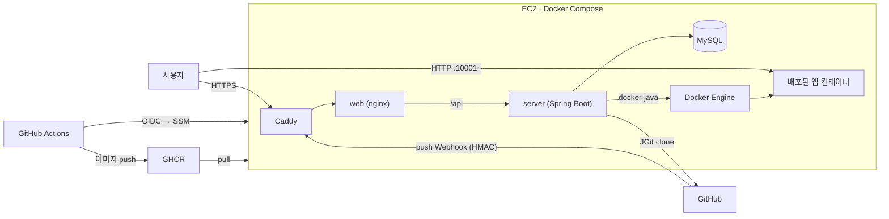
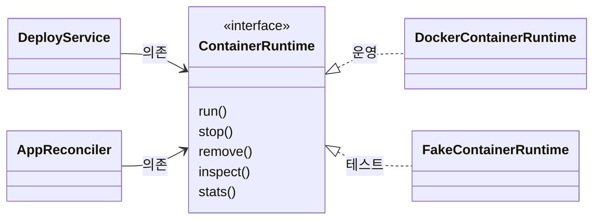

# Depolita

GitHub 저장소 주소를 입력하면 이미지를 빌드해서 컨테이너로 실행하고 접속 주소를 돌려주는 **미니 배포 플랫폼**입니다.

## 기술 스택

| 구분 | 사용 기술 |
| --- | --- |
| Backend | Java 21, Spring Boot 4, Spring Data JPA, Flyway, docker-java, JGit |
| Frontend | React 19, TypeScript, Vite, TanStack Query, Tailwind CSS |
| DB | MySQL 8.4 |
| Infra | AWS EC2, Terraform, Docker Compose, Caddy (HTTPS) |
| CI/CD | GitHub Actions, GHCR, OIDC, SSM Run Command |

## 아키텍처



## 주요 기능

- **저장소 주소로 배포**: 복제(JGit) → 이미지 빌드 → 컨테이너 실행(docker-java) → 접속 주소 반환
- **포트 자동 할당**: 10001~10999 중 DB 기록과 호스트의 실제 사용 여부를 함께 확인
- **재배포 · 중지 · 삭제**: 재배포 중에도 이전 버전이 계속 서비스되고, 같은 포트를 유지
- **push 자동 배포**: GitHub Webhook 서명(HMAC-SHA256) 검증 후 기본 브랜치 push 시 재배포
- **배포 이력**: 트리거(최초·수동·push), 커밋 SHA, 복제·빌드 소요 시간, 결과
- **상태 · 로그 · 리소스**: 배포 단계, 컨테이너 로그, 앱별 CPU·메모리 사용량
- **허용 계정**: `ALLOWED_ACCOUNTS` 에 등록된 GitHub 계정의 저장소만 배포

## 설계 포인트

- **재조정 루프**: 30초마다 DB 상태와 실제 컨테이너를 비교해 맞춘다. 컨테이너가 OOM 으로 죽거나 외부에서 지워져도 FAILED 로 정리하고 DB 에 없는 컨테이너는 고아로 보고 삭제한다.
- **2GB 서버에 맞춘 자원 제한**: 동시 빌드 1개, 활성 앱 5개, 앱마다 메모리 512MB · CPU 0.5, 빌드 메모리 1GB, 로그 10MB × 3.
- **앱 컨테이너 격리**: 앱 간 통신을 막는 전용 네트워크, `no-new-privileges`, PID 제한, EC2 메타데이터 접근 차단(IMDS hop limit 1).
- **키 없는 배포**: GitHub Actions 는 OIDC 로 AWS 역할을 받고 이 인스턴스에서 지정된 SSM 배포 문서만 실행할 수 있다. AWS 액세스 키를 저장하지 않고 SSH 도 열지 않는다.
- **자동 롤백**: 새 이미지(태그 = 커밋 SHA)가 헬스체크를 통과하지 못하면 직전 버전으로 되돌린다.

## 객체지향 설계

| 개념 | 적용한 곳 | 효과 |
| --- | --- | --- |
| 인터페이스 · 다형성 | `ContainerRuntime`, `ImageBuilder`, `SourceFetcher`, `HostPortChecker` | 서비스는 인터페이스에만 의존하고, Docker·JGit 구현체는 `infra` 에 둔다. 테스트에서는 `FakeContainerRuntime` 으로 바꿔 끼워 Docker 없이 검증한다 |
| 캡슐화 | `App` 엔티티 | 필드에 setter 가 없고 `startBuilding()`·`run()`·`stop()`·`fail()`·`redeploy()` 로만 상태가 바뀐다. 전이 검사(`changeStatus`)와 포트 반납(`releasePort`)은 `private` 으로 숨겼다 |
| 상속 | `CustomException` 하위 예외 8개 | 예외마다 `ErrorCode` 만 지정하고, `GlobalExceptionHandler` 한 곳에서 같은 응답 형식으로 처리한다 |
| 추상 클래스 | `BaseTimeEntity` | 생성·수정 시각을 공통으로 관리하고, 엔티티는 상속만 하면 된다 |
| 행위를 가진 enum | `AppStatus.canTransitionTo()` | "어떤 상태에서 어디로 갈 수 있는지" 규칙을 상태 자신이 갖는다 |
| 불변 객체 | 요청·응답 DTO, 이벤트(`record`) | 만든 뒤에는 값이 바뀌지 않아 스레드 간에 안전하게 넘긴다 |



## 실행 방법

```bash
cp .env.example .env               # DB 계정, ALLOWED_ACCOUNTS, DEPOLITA_API_KEY 입력
docker compose up -d mysql

cd server && ./gradlew bootRun     # API  http://localhost:8081
cd web && npm install && npm run dev   # 대시보드  http://localhost:5173
```

대시보드 접속 후 `.env` 의 `DEPOLITA_API_KEY` 를 입력합니다. 배포할 저장소에는 루트에 `Dockerfile` 이 있어야 합니다.

운영 배포는 `infra/` 의 Terraform 으로 EC2 를 만든 뒤, `main` 에 머지하면 GitHub Actions 가 자동으로 배포합니다.

## 프로젝트 구조

```
server/   Spring Boot API (배포 파이프라인, 재조정 루프)
web/      React 대시보드
infra/    Terraform (EC2, 보안그룹, EIP, IAM OIDC 역할, SSM 배포 문서)
deploy/   EC2 배포 스크립트 (헬스체크 + 자동 롤백)
caddy/    대시보드 HTTPS
.github/  CI (테스트 · terraform validate), CD (GHCR · SSM 배포)
```
